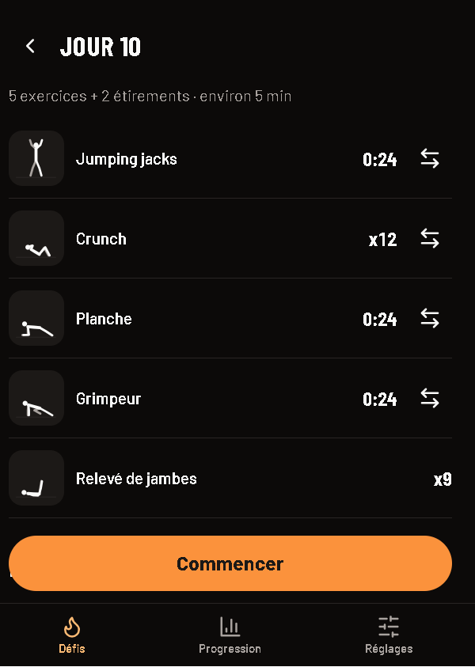

# 🔥 Fitness30 — Défis sportifs de 30 jours

**Fitness30** est une application web progressive (PWA) pour se mettre au sport chez soi, sans matériel. Choisis un défi de 30 jours, suis la séance du jour guidée par la minuterie, et regarde tes jours se cocher un à un. Quelques minutes par jour suffisent. Disponible en 9 langues. Sans compte, sans publicité, sans abonnement : tes données restent sur ton téléphone.

🔗 **Accéder à l'app** : [https://fitness30.vercel.app](https://fitness30.vercel.app)

---

## 👀 Aperçu de l'app

<table>
  <tr>
    <td align="center"> <b>Les défis</b></td>
    <td align="center"> <b>Les 30 jours</b></td>
    <td align="center"> <b>La séance du jour</b></td>
  </tr>
  <tr>
    <td align="center"> <b>La minuterie</b></td>
    <td align="center"> <b>La progression</b></td>
    <td></td>
  </tr>
</table>

*Captures réalisées avec des données d'exemple.*

---

## 📱 Les 3 onglets

| Onglet | Description |
|---|---|
| 🔥 **Défis** | Les 3 défis (Abdos, Fessiers, Corps entier), chacun en 3 niveaux. Grille des 30 jours avec les jours faits, les jours de repos et le jour à faire. |
| 📊 **Progression** | Jours d'affilée, nombre de séances, minutes et calories estimées, calendrier du mois avec tes jours d'entraînement. |
| ⚙️ **Réglages** | Langue, durée du repos, voix et bips pendant la séance, rappel quotidien dans ton agenda, sauvegarde et restauration de tes données, numéro de version tout en bas. |

---

## ✨ Fonctionnalités principales

- 🌍 **9 langues** : français, anglais, allemand, espagnol, portugais, italien, néerlandais, polonais, turc (celle du téléphone par défaut, modifiable dans Réglages)
- 🏋️ **3 défis de 30 jours** : Abdos, Fessiers, Corps entier, chacun en niveau débutant, intermédiaire ou avancé
- 📈 **Difficulté qui monte en douceur** jour après jour, avec un jour de repos tous les 4 jours
- 🔄 **Changer de niveau sans perdre ses jours** : tu gardes ta progression
- ⏱️ **Séance guidée** : décompte « Prêt ? », minuterie ou compteur de répétitions, repos avec l'exercice suivant, pause, précédent, suivant
- ➕ **+20 s de repos** quand tu en as besoin, et durée du repos réglable
- 🔁 **Remplacer un exercice** par une variante plus facile ou plus dure
- 🧘 **Étirements** à la fin de chaque séance
- 🙂 **« C'était comment ? »** après la séance : la suite s'adapte si c'était trop facile ou trop dur
- 🔊 **Voix et bips** pour suivre la séance sans regarder l'écran (activables dans Réglages)
- 💡 **L'écran reste allumé** pendant la séance
- ▶️ **Reprendre une séance coupée** (appel, appli fermée) là où tu t'étais arrêté
- 📅 **Rappel quotidien** ajouté à l'agenda de ton téléphone, à l'heure de ton choix
- 🗓️ **Calendrier et série** de jours d'affilée pour garder la motivation
- 💾 **Sauvegarde et restauration** des données dans un fichier
- ✈️ **Fonctionne hors connexion** une fois installée

---

## 🗓️ Historique des versions

| Version | Date | Nouveautés |
|---|---|---|
| 1.2.1 | 14 nov. 2026 | Démo de la planche corrigée (avant-bras posés vers l'avant) |
| **1.2** | 14 nov. 2026 | Nouvelles démos animées pour les 22 exercices |
| **1.1** | 14 nov. 2026 | 9 langues (la voix parle aussi la langue choisie), numéro de version dans Réglages |
| **1.0** | 14 nov. 2026 | Première version : 3 défis en 3 niveaux, séance guidée, étirements, variantes, ressenti, rappel quotidien, sauvegarde |

Le numéro de version s'affiche tout en bas de l'onglet **Réglages**.

---

## 📲 Installation sur mobile

### 🍏 iPhone (Safari)

1. Ouvre [https://fitness30.vercel.app](https://fitness30.vercel.app) dans **Safari**
2. Appuie sur l'icône **Partage** (le carré avec une flèche vers le haut) 🔗
3. Sélectionne **Sur l'écran d'accueil** ➕
4. Confirme en appuyant sur **Ajouter**

L'application apparaît alors comme une app native sur ton écran d'accueil. 🎉

### 🤖 Android (Chrome)

1. Ouvre [https://fitness30.vercel.app](https://fitness30.vercel.app) dans **Chrome**
2. Appuie sur le menu **⋮** (les 3 points en haut à droite)
3. Sélectionne **Ajouter à l'écran d'accueil** (ou **Installer l'application**)
4. Confirme l'ajout

L'application s'installe comme une app classique, avec son icône dédiée. 🎉

🔊 Pour entendre la voix et les bips, monte le son du téléphone et, sur iPhone, désactive le mode silencieux.

💾 Pense à faire une sauvegarde de temps en temps (onglet **Réglages**, en bas) : tes données sont perdues si tu désinstalles l'app.
