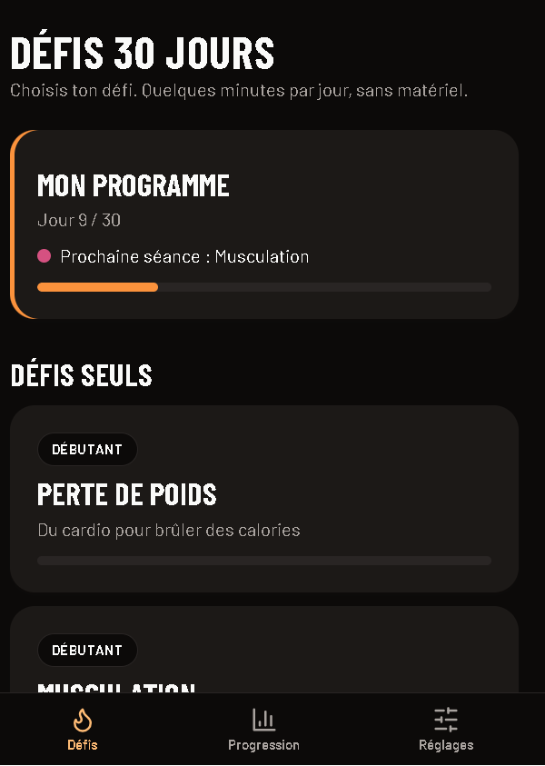
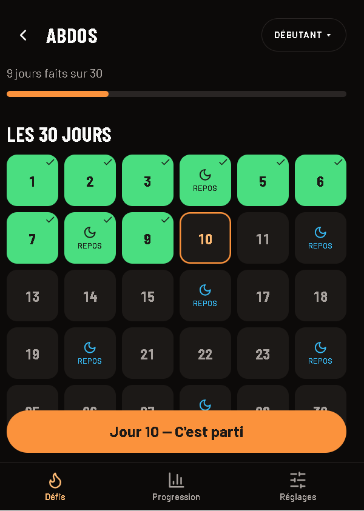
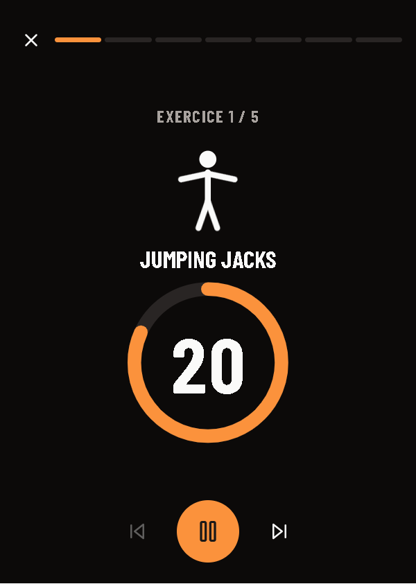
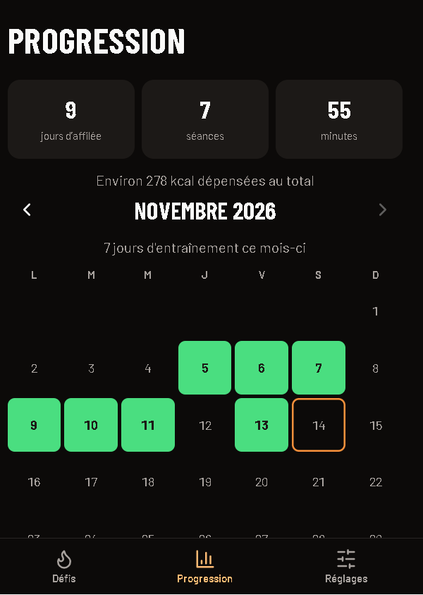
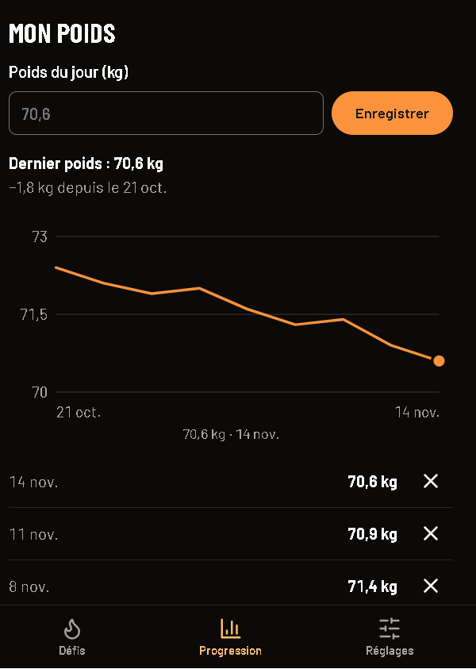
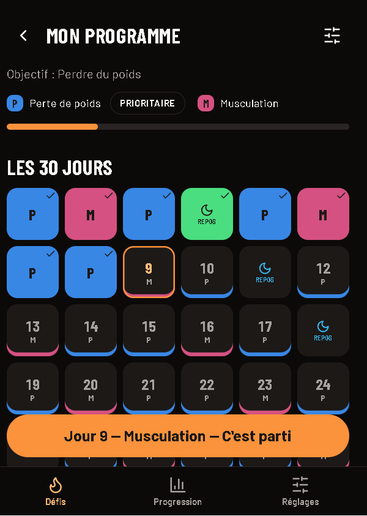
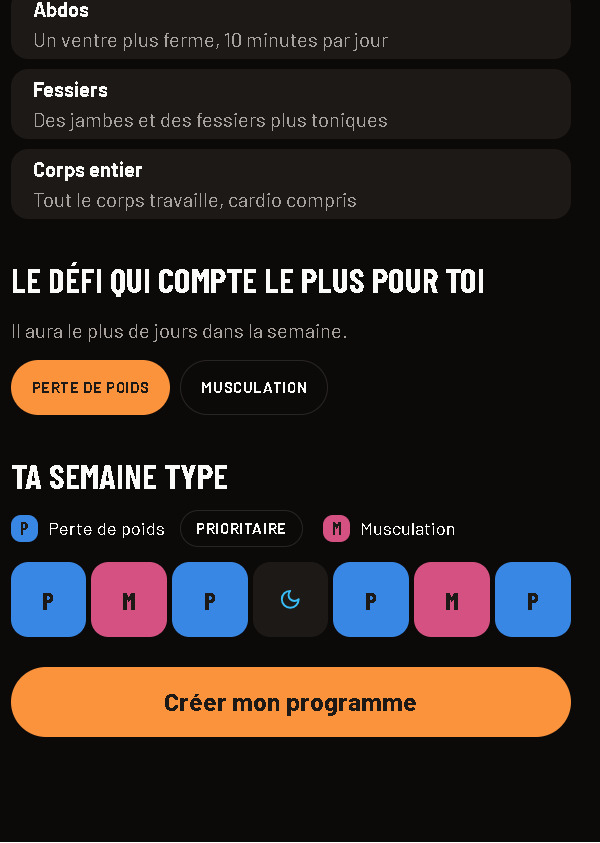

# 🔥 Fitness30 — Défis sportifs de 30 jours

**Fitness30** est une application web progressive (PWA) pour se mettre au sport chez soi, sans matériel. Choisis un défi de 30 jours ou combine-en plusieurs dans un programme fait pour ton objectif, suis la séance du jour guidée par la minuterie, et regarde tes jours se cocher un à un. Quelques minutes par jour suffisent. Disponible en 9 langues. Sans compte, sans publicité, sans abonnement : tes données restent sur ton téléphone.

🔗 **Accéder à l'app** : [https://fitness30.vercel.app](https://fitness30.vercel.app)

---

## 👀 Aperçu de l'app

<table>
  <tr>
    <td align="center"> <b>Les défis</b></td>
    <td align="center"> <b>Les 30 jours</b></td>
    <td align="center"> <b>La séance du jour</b></td>
  </tr>
  <tr>
    <td align="center"> <b>La minuterie</b></td>
    <td align="center"> <b>La progression</b></td>
    <td align="center"> <b>Le poids</b></td>
  </tr>
  <tr>
    <td align="center"> <b>Mon programme</b></td>
    <td align="center"> <b>Créer son programme</b></td>
    <td></td>
  </tr>
</table>

*Captures réalisées avec des données d'exemple.*

---

## 📱 Les 3 onglets

| Onglet | Description |
|---|---|
| 🔥 **Défis** | **Mon programme** en haut (plusieurs défis dans un même planning en couleurs), puis les 5 défis seuls (Perte de poids, Musculation, Abdos, Fessiers, Corps entier), chacun en 3 niveaux. Grille des 30 jours avec les jours faits, les jours de repos et le jour à faire. |
| 📊 **Progression** | Jours d'affilée, nombre de séances, minutes et calories estimées, calendrier du mois avec un point de couleur par défi, suivi du poids avec sa courbe et ton IMC. |
| ⚙️ **Réglages** | Langue, thème (auto, clair ou sombre), durée du repos, voix et bips pendant la séance, rappel quotidien dans ton agenda, ton objectif (modifiable à tout moment), sauvegarde et restauration de tes données, numéro de version tout en bas. |

---

## ✨ Fonctionnalités principales

- 🌍 **9 langues** : français, anglais, allemand, espagnol, portugais, italien, néerlandais, polonais, turc (choisie au premier lancement, modifiable dans Réglages)
- 🏋️ **5 défis de 30 jours** : Perte de poids, Musculation, Abdos, Fessiers, Corps entier, chacun en niveau débutant, intermédiaire ou avancé
- 🗓️ **Mon programme** : combine 2 ou 3 défis ; l'appli construit un planning de 30 jours d'après ton objectif et donne le plus de jours au défi qui compte le plus pour toi. Chaque défi a sa couleur et son initiale sur le calendrier
- 🎯 **Objectif modifiable** à tout moment : le défi prioritaire et la suite du planning s'adaptent, les jours déjà faits restent
- 📈 **Difficulté qui monte en douceur** jour après jour, avec un jour de repos tous les 4 jours
- 🔄 **Changer de niveau sans perdre ses jours** : tu gardes ta progression
- ⏱️ **Séance guidée** : décompte « Prêt ? », minuterie ou compteur de répétitions, repos avec l'exercice suivant, pause, précédent, suivant
- ➕ **+20 s de repos** quand tu en as besoin, et durée du repos réglable
- 🔁 **Remplacer un exercice** par une variante plus facile ou plus dure
- 🧘 **Étirements** à la fin de chaque séance
- 🙂 **« C'était comment ? »** après la séance : la suite s'adapte si c'était trop facile ou trop dur
- 🔊 **Voix et bips** pour suivre la séance sans regarder l'écran (activables dans Réglages)
- 💡 **L'écran reste allumé** pendant la séance
- ▶️ **Reprendre une séance coupée** (appel, appli fermée) là où tu t'étais arrêté
- 📅 **Rappel quotidien** ajouté à l'agenda de ton téléphone, à l'heure de ton choix
- 🗓️ **Calendrier et série** de jours d'affilée pour garder la motivation
- ⚖️ **Suivi du poids et IMC** : note ton poids quand tu veux, regarde ta courbe évoluer et ton IMC se mettre à jour
- 🌗 **Thème clair ou sombre** au choix, ou automatique comme ton téléphone
- 💾 **Sauvegarde et restauration** des données dans un fichier
- ✈️ **Fonctionne hors connexion** une fois installée

---

## 🗓️ Historique des versions

| Version | Date | Nouveautés |
|---|---|---|
| **1.5** | 14 nov. 2026 | Choix de la langue au premier lancement, questionnaire « Et toi ? » (âge, sexe, taille, poids), IMC dans Progression |
| **1.4.1** | 14 nov. 2026 | Corrections : « Arrêter le programme » revient bien aux défis, meilleure lecture par les lecteurs d'écran |
| **1.4** | 14 nov. 2026 | Mon programme (plusieurs défis dans un planning selon ton objectif, code couleur), défis Perte de poids et Musculation, 5 nouveaux exercices, objectif modifiable |
| **1.3** | 14 nov. 2026 | Suivi du poids avec courbe, choix du thème clair ou sombre |
| 1.2.1 | 14 nov. 2026 | Démo de la planche corrigée (avant-bras posés vers l'avant) |
| **1.2** | 14 nov. 2026 | Nouvelles démos animées pour les 22 exercices |
| **1.1** | 14 nov. 2026 | 9 langues (la voix parle aussi la langue choisie), numéro de version dans Réglages |
| **1.0** | 14 nov. 2026 | Première version : 3 défis en 3 niveaux, séance guidée, étirements, variantes, ressenti, rappel quotidien, sauvegarde |

Le numéro de version s'affiche tout en bas de l'onglet **Réglages**.

---

## 📲 Installation sur mobile

### 🍏 iPhone (Safari)

1. Ouvre [https://fitness30.vercel.app](https://fitness30.vercel.app) dans **Safari**
2. Appuie sur l'icône **Partage** (le carré avec une flèche vers le haut) 🔗
3. Sélectionne **Sur l'écran d'accueil** ➕
4. Confirme en appuyant sur **Ajouter**

L'application apparaît alors comme une app native sur ton écran d'accueil. 🎉

### 🤖 Android (Chrome)

1. Ouvre [https://fitness30.vercel.app](https://fitness30.vercel.app) dans **Chrome**
2. Appuie sur le menu **⋮** (les 3 points en haut à droite)
3. Sélectionne **Ajouter à l'écran d'accueil** (ou **Installer l'application**)
4. Confirme l'ajout

L'application s'installe comme une app classique, avec son icône dédiée. 🎉

🔊 Pour entendre la voix et les bips, monte le son du téléphone et, sur iPhone, désactive le mode silencieux.

💾 Pense à faire une sauvegarde de temps en temps (onglet **Réglages**, en bas) : tes données sont perdues si tu désinstalles l'app.
